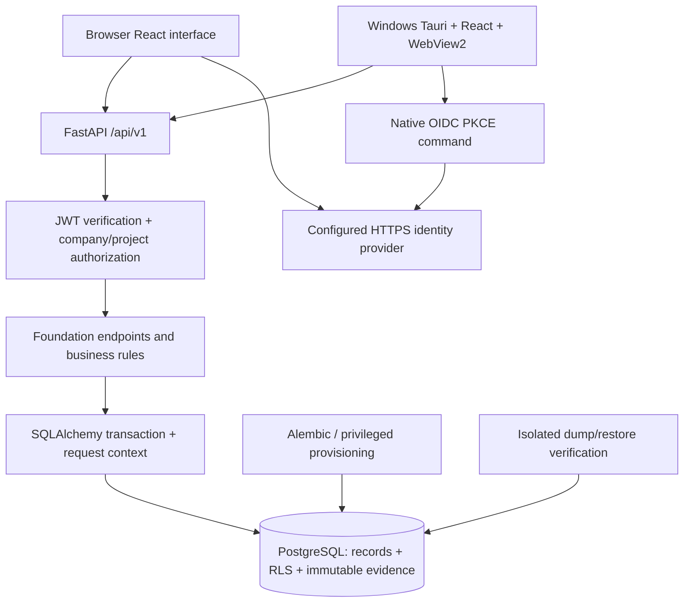
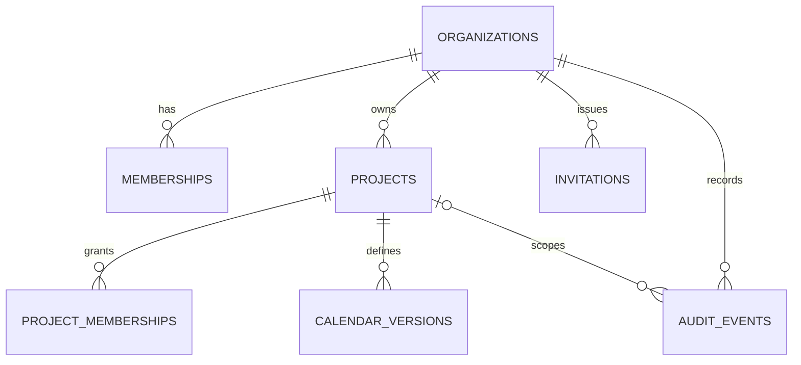

# ConstructPM AI — Application Specification and Rebuild Blueprint

**Application version:** 0.1.0  
**Specification date:** 11 November 2026  
**Implemented scope:** Phase 1 construction-project management foundation  
**Audience:** AI coding agents, software maintainers, testers and technical owners  
**Status:** As-built specification with explicit requirements, acceptance criteria and outstanding work

## 1. How to use this specification

This document describes the application actually built, rather than presenting the complete future product as implemented. It is intended to let another coding agent understand the system, maintain its behavior, or rebuild a compatible foundation.

Interpret the following labels carefully:

* **Implemented:** behavior present in the inspected source. This does not automatically mean production acceptance.
* **Verified:** behavior exercised by the recorded automated checks or demonstration, with the verification boundary stated.
* **Required hardening:** an identified correction or acceptance gap; it must not be assumed complete.
* **Future:** desired product functionality that has not been implemented or authorized as the next development phase.

For maintenance, inspect the owning source before changing behavior. For a rebuild, preserve tenant boundaries, stable identifiers, record relationships, permission rules, immutable evidence and API compatibility. Do not copy actual runtime secrets, local database contents or machine-specific toolchain paths into a new application.

The current source lives in the supplied `ConstructPM_AI` folder. In this document, repository-relative paths refer to that folder. Its location in the original workspace is `C:\Users\Administrator\Documents\Codex\2026-11-11\files-pasted-by-the-user-ai\outputs\ConstructPM_AI`. That absolute location is not an application requirement.

## 2. Purpose and product boundaries

### 2.1 Purpose

ConstructPM AI is intended to become a commercial, multi-tenant construction project management application. Independent construction companies should be able to manage their own projects and people without exposing records to other companies. The long-term product covers civil, structural, architectural, mechanical, electrical, plumbing and other disciplines.

The implemented foundation establishes:

1. A person's authenticated identity.
2. Companies that person belongs to.
3. Company administration and project-specific roles.
4. Projects and explicit project-access assignments.
5. Versioned working-calendar definitions.
6. A permanent history of foundation changes.
7. A usable browser interface and Windows desktop shell.

It does **not** yet calculate construction schedules or provide AI functionality. “AI” is the product name and future direction; it is not evidence that an LLM is currently operating inside the application.

### 2.2 Current deployment model

The Windows application bundles the frontend only. The API and PostgreSQL database run separately. Installing the desktop application does not install, start or provision the backend, database, cloud hosting or identity provider.

The current demonstration uses:

| Component | Demonstration address / behavior |
|---|---|
| FastAPI service | `http://127.0.0.1:8000` |
| Browser development interface | `http://127.0.0.1:1420` |
| PostgreSQL | Loopback host, demonstration port 55432 |
| Packaged Windows frontend | Bundled assets displayed through WebView2; observed origin `http://tauri.localhost/` |
| Identity | Explicit local-development identities, visibly labeled as demonstration accounts |

These addresses are defaults, not production hosting requirements. The backend remains the system of record regardless of whether the user opens the browser or desktop frontend.

### 2.3 Scope matrix

| Capability | Current state |
|---|---|
| Company registration and company switching | Implemented |
| Company membership, invitations and activation | Implemented |
| Project creation, details, name changes and archiving | Implemented |
| Eight project roles and independent project-access revocation | Implemented |
| Working-calendar definitions and immutable versions | Implemented |
| Audit history | Implemented |
| PostgreSQL tenant/project visibility policies | Implemented |
| Development sign-in | Implemented and demonstrated locally |
| Production OIDC token validation and PKCE integration code | Implemented; live provider acceptance pending |
| Windows executable and NSIS setup generation | Built successfully; setup installation/uninstallation pending |
| WBS, tasks, Gantt, dependencies, CPM, baselines | Future Phase 2 |
| Delay analysis, scenarios, approvals, reports | Future Phase 3 |
| Android, SQLite offline cache and synchronization | Future Phase 4 |
| Drawing revisions, measurements, take-offs and AI suggestions | Future Phase 5 |
| Subscription billing, production cloud operations and commercial release | Future Phase 6 |

Do not interpret sidebar labels for later phases as functional modules.

## 3. Terminology and identity model

| Term | Definition |
|---|---|
| User / person | A verified identity from a configured provider, or an explicitly enabled local demonstration identity |
| Organization / company / tenant | The company-level data boundary; these terms refer to the same entity |
| Company membership | The connection between a user and an organization, including company role and active state |
| Project membership / assignment | A user's project-specific role and active access within a company |
| Company administrator | A user with administrative authority in one organization, not a global administrator of all tenants |
| Calendar identity | A stable `calendar_id` shared by the versions of one project calendar |
| Calendar version | A distinct immutable record with its own ID, version number, definition and hash |
| Row version | An integer used to detect stale edits to mutable records |
| Audit event | An append-only record of a foundation business change |

A person signs in first and then selects a company. There is no separate company password or company-login credential. One person can belong to multiple companies with different roles.

Never use company names, project names, email addresses or visible dropdown position as a substitute for stable record IDs. Company names are not currently required to be unique. Project codes are unique within a company, not globally.

## 4. Architecture



### 4.1 Implementation organization

The current backend is a small application, not a fully separated collection of domain services. Most endpoint/business orchestration is in `services/api/app/main.py`. Supporting responsibilities are separated into authentication, settings, database/session utilities, models and validation schemas.

The frontend is a React single-page application with local component state. Most screens currently live in `apps/desktop/src/main.tsx`. There is no client-side domain database, persistent access-token store, offline outbox, background synchronization engine or state-management framework.

The native Rust layer provides the desktop host and one OIDC sign-in command. It does not contain project persistence or scheduling calculations.

### 4.2 Request lifecycle

1. The client sends a bearer access token for a protected endpoint.
2. The API verifies the token and derives a stable internal user ID.
3. A SQLAlchemy session starts a database transaction.
4. Trusted server code sets transaction-local actor context.
5. The user's basic profile is inserted on first use if absent.
6. Company-scoped endpoints establish and validate active company membership.
7. Project-scoped endpoints verify project visibility and the permission for the action.
8. Queries and writes run under PostgreSQL row-level security.
9. A successful business mutation and its audit event commit in the same transaction. Failure rolls both back.
10. Transaction-local settings expire on commit/rollback rather than leaking through pooled connections.

Clients must never connect directly to PostgreSQL or receive database/migration credentials.

## 5. Users, roles and permissions

### 5.1 Company roles

* `administrator`: administers that company, its members, projects, assignments, calendars and audit history.
* `member`: obtains access only to explicitly assigned projects and their permitted features.

A company administrator has effective administrator access to projects in that company. Assigning that person a lower project role does not remove company-administrator authority. A different nonadmin account must be used to test supervisor restrictions.

### 5.2 Project roles

The exact supported codes are:

`project_manager`, `planner`, `site_engineer`, `supervisor`, `quantity_surveyor`, `executive`, `subcontractor`, `guest`.

| Action | Company administrator | Assigned project manager | Assigned planner | Other assigned project roles |
|---|---|---|---|---|
| Create another company | Yes, as an authenticated person | Yes, as an authenticated person | Yes, as an authenticated person | Yes, as an authenticated person |
| Read current company projects | All projects | Assigned projects | Assigned projects | Assigned projects |
| Create a project | Yes | No | No | No |
| Read assigned project and calendars | Yes | Yes | Yes | Yes |
| Edit project name/archive state | Yes | Yes | No | No |
| Create calendar/version | Yes | Yes | Yes | No |
| List project assignments through API | Yes | Yes | No | No |
| Create/change/revoke project assignments | Yes | No | No | No |
| Invite/change company members | Yes | No | No | No |
| Read company audit history | Yes | No | No | No |

The initial UI exposes People and Audit history only to company administrators. A project manager's assignment-list API permission does not imply a dedicated assignment-management screen for that role.

**Important:** SQL policies enforce tenant/project visibility, but do not independently implement every action-level role distinction in this matrix. API authorization remains mandatory. Do not expose the database runtime credential as a way to bypass endpoints.

## 6. Functional specification

### F01 — Sign-in, identity and sign-out

**Purpose:** establish who is acting without placing passwords or private provider credentials in the client.

**Implemented behavior:**

* The frontend loads public authentication configuration from the API.
* Development mode shows only configured demonstration identities, with a clear development warning.
* Real-identity mode presents secure sign-in and requires configured issuer/client information.
* After sign-in, the client requests the user's identity and accessible companies.
* Tokens are held in memory. Reloading or closing the interface requires sign-in again. Silent renewal and persistent refresh-token storage are not implemented.
* Sign-out clears the client token, user/company/project state and returns navigation to Overview. It does not necessarily sign the person out of the identity provider's browser session.

**Identity derivation:** the internal user ID is UUID5 using the URL namespace and `issuer + "|" + subject`. User IDs therefore depend on issuer and subject, not on email alone. Ordinary new business record IDs are UUID4.

**Provider-token validation:** the API accepts RS256 in real-provider mode and requires `exp`, `iat`, `sub`, `iss`, `aud`, and `email`. Issuer and audience must match configuration. `email_verified` must be boolean `true`; subject must be a string. Email is trimmed/lowercased and validated for a basic address shape/length. Invalid or expired identities return 401.

**Development rules:** development identity must be explicitly enabled, environment must be `development`, and the configured signing secret must contain at least 32 characters. Tokens use HS256, a dedicated development issuer and a 30-minute expiry. Token issuance accepts only allowlisted email addresses and loopback requests (plus the test client in tests). Production defaults do not enable this endpoint.

**Stored information:** stable user ID, email and display name. Profile information is initially materialized on first API use; a profile-editing/identity-change reconciliation feature does not exist yet.

**Acceptance:** reject invalid signatures, incorrect issuer/audience, expired tokens, algorithm substitution and unverified email; never silently fall back from failed real sign-in to a demo identity.

### F02 — Company registration and switching

**Purpose:** create a tenant and establish its first responsible administrator.

**Input:** company name (2–160 characters) and a valid IANA timezone; current default is `Pacific/Port_Moresby`.

**Behavior:** registration creates the organization, an active administrator membership for the authenticated person and an `organization.registered` audit event in one transaction. No subscription, payment or email is created.

Company discovery returns only active memberships of the current identity. The dropdown shows company names but internally selects organization IDs. After discovery, retain a valid current selection; otherwise select the first accessible company. After invitation acceptance, prefer the newly joined company.

**UI rule:** company selector, Register a company, Join a company, signed-in identity and Sign out must remain visible at narrow widths. These controls belong in the responsive account bar rather than a sidebar section that disappears in an embedded browser panel.

**Acceptance:** different companies cannot see one another's projects; an identity without company membership cannot establish authority merely by supplying a known organization ID. Duplicate company display names must not cause records to be merged.

### F03 — Company invitations and membership administration

**Purpose:** let an administrator admit a verified person to a specific company.

**Invitation input:** email and company role (`member` by default, or `administrator`). Normalize email to lowercase.

**Creation:** generate a URL-safe token from 32 random bytes. Store its SHA-256 hash, intended email/role and a three-day expiry. Return the raw token once to the administrator for secure copying. Do not store the raw token in audit details. No email delivery integration exists.

**Acceptance workflow:**

1. The invitee signs in with the exact verified email associated with the invitation.
2. Choose Join a company, paste the token and submit Accept invitation.
3. The API hashes the supplied token and locks the invitation row.
4. Validate token, intended email, expiry and unused state.
5. Insert company membership, record acceptance time and append `invitation.accepted` atomically.
6. Refresh company discovery, select the joined organization and show Overview.

Expired, mismatched or already-used invitations return a generic 404. Acceptance is single-use. Reinviting an identity that already has a membership does not implement an upsert/reactivation flow; unique constraints may return 409. Use membership administration for existing members.

**Membership changes:** company administrators may change role/active state using the current row version. At least one active administrator must remain. A person cannot deactivate their own membership through this endpoint; another administrator must do it. Tenant-scoped transaction advisory locking serializes membership changes and administrative authority is rechecked after acquiring that lock.

Deactivation blocks company access without deleting the membership or historical evidence. Existing project assignments are retained. Reactivation can make still-active project assignments effective again; it does not mean those assignment records were recreated.

**Acceptance:** nonadmins cannot invite/escalate roles; wrong email and replay fail; concurrent demotions cannot remove all active administrators.

### F04 — Projects

**Purpose:** define project identity and context before introducing scheduling.

**Creation input:**

| Field | Rule |
|---|---|
| `code` | 1–40 characters; ASCII letters, numbers, underscore and hyphen; unique within organization |
| `name` | 2–160 characters |
| `timezone` | Valid IANA timezone |
| `start_date` | Valid date accepted by API and serialized as ISO `YYYY-MM-DD` |
| `discipline` | 2–60 characters; UI offers Civil, Structural, Architectural, Mechanical, Electrical, Plumbing, Multidisciplinary and Other |

The API does not restrict discipline to that UI list. The project start is project metadata, not a calculated CPM date.

Administrators may create projects. Administrators and assigned project managers may change only name and archive state in the implemented PATCH contract. Updating code, discipline, timezone or start date is not currently exposed by that endpoint.

Archived projects remain stored and appear with an Archived label. Archiving does not currently delete, hide, freeze or revoke access to the project. A future write-freeze policy would be a separate behavior change.

Project list requests use UUID-string ordering with an `after` cursor. The frontend fetches all pages before presenting its project list. Default page size is 50; maximum is 200. Administrators see company projects; ordinary members see their active assignments only.

**Acceptance:** reject cross-company references; show inaccessible projects as 404; preserve project history; reject stale edits instead of silently overwriting another change.

### F05 — Project assignment, role changes and revocation

**Purpose:** grant a company member access to a specific project with a specific role.

Only a company administrator may create/change assignments. The user must be an active member of that company when an assignment is created. The organization/project/user combination is unique. Creating a duplicate returns 409; use the versioned update endpoint to change an existing assignment.

Assignment updates may change role and active state, but cannot change the assigned user's identity. Independent project revocation sets assignment active to false, leaving company membership and evidence intact. Restoring it sets active to true. An inactive company membership still blocks access even if a project assignment is active.

The UI requires an explicit member selection and confirms the assigned email and role after saving. Do not silently assign the first dropdown user: this previously caused the planner identity to receive a supervisor project role while the actual supervisor remained unassigned. The project-role dropdown currently defaults to Project manager; requiring an explicit role choice is a possible safety improvement.

Company membership and project assignment are distinct requirements. An accepted invitation alone does not make all company projects visible.

**Acceptance:** a supervisor can discover/view an assigned project and calendar but cannot edit calendars, manage members or view audit history. Verify the actual invitee's user ID, not just a role label on another person's assignment.

### F06 — Working calendars and versions

**Purpose:** preserve precise working-time definitions for future scheduling.

The current feature validates and stores calendar definitions. It does not perform working-time addition/subtraction, schedule calculation, DST expansion or holiday-aware forecasting.

**Definition input:** name, timezone, nominal duration-day minutes, weekly shifts and date exceptions.

```json
{
  "name": "Standard site week",
  "timezone": "Pacific/Port_Moresby",
  "nominal_minutes_per_day": 480,
  "week": {
    "1": [["08:00", "12:00"], ["13:00", "17:00"]],
    "2": [["08:00", "12:00"], ["13:00", "17:00"]],
    "3": [["08:00", "12:00"], ["13:00", "17:00"]],
    "4": [["08:00", "12:00"], ["13:00", "17:00"]],
    "5": [["08:00", "12:00"], ["13:00", "17:00"]],
    "6": [],
    "7": []
  },
  "exceptions": {"2027-01-01": []}
}
```

**Rules:**

* ISO weekdays are strings `1` through `7`, Monday through Sunday; all seven keys are required and no others are accepted.
* At least one weekly working interval must exist.
* A shift is a start/finish pair in HH:MM. Times are minute precision; `24:00` can serve as a finish boundary.
* Each interval must have positive duration; intervals must be ordered and nonoverlapping. Adjacent shifts are allowed.
* Split overnight work across days rather than entering an interval whose finish is earlier than its start.
* Empty day arrays mean no work. Exceptions use valid ISO dates and replace that date's normal pattern; an empty exception is nonworking and a nonempty one is a replacement work pattern.
* At most 3,660 exceptions are accepted by current validation.
* Nominal duration-day minutes must be an integer from 1 through 1,440. It is explicit duration metadata; it is not automatically derived from every day's shifts and is not 24 elapsed hours.
* Calendar timezone need not currently equal project timezone. Interpret and validate such differences explicitly when the scheduling engine is added.

**Versioning:** a new logical calendar receives a new `calendar_id`, version 1 and a distinct record ID. A subsequent save through the version endpoint inserts another immutable record with the same calendar identity and incremented version. Lock the parent project when assigning the next number. Never overwrite an older definition.

**Hash:** SHA-256 of the validated definition serialized with Python JSON using sorted keys and compact separators `(',', ':')`. Hash inputs include name, timezone, nominal minutes, week and exceptions; record IDs/timestamps are not part of the definition hash.

The list returns every version, ordered by calendar identity and descending version. The desktop editor edits weekly shifts and nonworking exceptions. It preserves existing custom working-date exceptions, but does not yet offer dedicated controls to edit those custom exceptions.

**Acceptance:** supervisors see read-only calendars; administrators/PMs/planners can create versions; invalid overlaps/timezones/dates fail; older hashes/definitions remain unchanged; runtime update/delete attempts are denied.

### F07 — Audit history

**Purpose:** retain who changed company/project foundation records and what changed.

Record actor, organization, optional project, action, entity ID, details, request ID and UTC creation time. Audit inserts participate in the same transaction as the business operation. Do not log access tokens, raw invitations, signing keys or private provider credentials.

Supported action names are:

`organization.registered`, `membership.changed`, `invitation.created`, `invitation.accepted`, `project.created`, `project.changed`, `project.membership.created`, `project.membership.changed`, `calendar.version.created`.

History is administrator-only. Order newest first by `(created_at, id)` descending. Its cursor is URL-safe base64 JSON containing the final row's aware timestamp and UUID; subsequent pages request older tuples. Validate cursor length/format. This is an audit-history paginator, not an offline synchronization feed.

The UI shows time in the selected company timezone, action, actor and expandable details. Some actors display as IDs if their email is not in current client state. Company/project history is append-only for normal runtime operations; privileged database administrators remain outside the application's trust boundary.

### F08 — Overview, navigation and client state

Overview shows company name/timezone, accessible project count, current company role and project summaries. Active-project count excludes archived projects. It does not show earned progress, CPM status, forecast completion or physical percentage. A checklist is informational and not an automated acceptance certificate.

Core navigation: Overview, Projects, Calendars; administrators also see People and Audit history. Join company is an account-bar route. Returning from an unauthorized People/Audit page after account/role changes must navigate to Overview rather than display an empty page.

On company/account changes, clear old project/calendar/member/assignment/audit selections and in-memory invitation values. Protect asynchronous results with generation/scope checks so a late response does not populate the wrong workspace. A user may need to revisit or sign in again to refresh assignments changed elsewhere; no push notification/live update channel exists.

Show busy state, safe validation errors, stale-edit guidance and save confirmations. Background panel loading must not erase a mutation's success message immediately. Do not display a successful save when the API failed.

## 7. Data model and persistence

### 7.1 Physical conventions

The current PostgreSQL schema uses UUID-formatted values stored as `varchar(36)`, not native PostgreSQL UUID columns. Most IDs are generated by Python. Timestamps use timezone-aware database columns and UTC application defaults. Project start dates are presently ISO strings in `varchar(10)`, validated as dates by the API. Calendar structures/details use PostgreSQL JSON through SQLAlchemy, not an implemented JSONB domain schema.

Do not change these physical types silently during maintenance. A rebuild may choose stronger types only with a clear compatibility/migration decision and equivalent relationship checks.

There are eight application tables plus Alembic's migration-version table. Role catalogs, WBS, tasks, baselines, actuals, approvals, documents and subscriptions have no implemented tables.

### 7.2 Tables

| Table | Fields and important constraints |
|---|---|
| `users` | `id` PK; `email` up to 320; `name` up to 160. Self-scoped identity record. |
| `organizations` | `id` PK; `name` up to 160; `timezone` up to 100; `created_by`; `created_at`. Name is not unique. |
| `memberships` | `id` PK; organization FK; `user_id`, `email`, role, active, row_version. Unique organization/user; role check administrator/member. |
| `projects` | `id` PK; organization FK; code, name, timezone, start_date, discipline, archived, row_version, created_at. Unique organization/code and organization/id. |
| `project_memberships` | `id` PK; organization, project, user, role, active, row_version. Composite organization/project FK; unique organization/project/user; eight-role check. Active field added in migration 0002. |
| `invitations` | `id` PK; organization FK; intended email/role; globally unique token_hash; expires_at; nullable accepted_at. Raw tokens are not stored. |
| `calendar_versions` | `id` PK; organization, project, calendar_id, version, name, timezone, nominal_minutes_per_day, week JSON, exceptions JSON, content_hash, created_by, created_at. Composite project FK; unique organization/project/calendar/version; positive version/minute checks. |
| `audit_events` | `id` PK; organization FK; nullable project with composite organization/project FK; actor_id, action, entity_id, details JSON, request_id, created_at. Append-only. |
| `alembic_version` | Current migration revision. Runtime has read-only access for startup compatibility validation. |

The current schema does not attach a foreign key from every actor/user reference to `users`, nor a composite FK from project assignment to company membership. API validation and RLS helpers enforce those membership/access conditions. Do not document nonexistent database constraints as implemented guarantees.

### 7.3 Relationships



User IDs also logically connect identities to memberships, assignments and actors. The diagram's project audit relationship is optional on an event; the organization is always required.

### 7.4 Immutability and deletion

No business deletion endpoints exist. Deactivate memberships, revoke assignments or archive projects instead of removing history. Calendar versions and audit events have database triggers rejecting update/delete, in addition to restricted grants. These controls do not prevent a trusted database superuser from changing the database; manage that credential separately.

## 8. API contracts

### 8.1 Common rules

The API base is `/api/v1` except `/health`. Payloads are JSON; timestamps use ISO formatting, IDs are UUID strings and durations in the calendar definition are integer minutes. Typed input models generally reject unknown fields and strip whitespace. Invitation acceptance currently uses a generic dictionary body rather than a strict typed DTO.

Protected requests use `Authorization: Bearer <access-token>`. Mutable project and membership PATCH requests require `If-Match: "<row_version>"`. Missing version returns 428; stale version returns 412. Successful changes increment row_version. Project detail GET returns an ETag. List/create/update responses also expose the version where applicable.

Default project/audit page limit is 50, maximum 200. Other lists currently return all scoped rows without pagination. Creation POSTs do not implement generic idempotency receipts. The client performs no automatic write retry; after a connection loss with unknown commit status, refresh before resubmitting.

Errors normally contain `code`, safe `message`, `request_id` and optional field locations/messages. Validation errors do not echo submitted values. Responses set `Cache-Control: no-store`, `X-Content-Type-Options: nosniff` and a server-generated `X-Request-ID`.

| Status | Meaning |
|---|---|
| 401 | Missing, invalid or expired authentication |
| 403 | Authenticated scope known, but action not permitted |
| 404 | Missing/inaccessible company, project, invitation or member; avoid tenant enumeration |
| 409 | Duplicate/conflicting record, last-admin rule or invalid membership transition |
| 412 | Stale version |
| 422 | Invalid payload/identifier/calendar/cursor |
| 428 | Required If-Match missing |

CORS uses an explicit origin list, permits GET/POST/PATCH and Authorization/Content-Type/If-Match headers, and exposes ETag/request ID. Cookie credentials are not used by this client.

### 8.2 Endpoint inventory

`O = /organizations/{o}` and `P = O/projects/{p}` in this table. The appendix contains the exact OpenAPI path snapshot.

| Endpoint | Behavior and authority |
|---|---|
| `GET /health` | Process liveness and phase indicator; not a comprehensive ongoing database-readiness probe |
| `GET /auth/config` | Public mode/issuer/audience and demo emails only when development is enabled |
| `POST /dev/token?email=...` | Development-only loopback token issuance; route absent in real-provider mode |
| `GET /me` | Verified identity ID/email/name; materializes initial user record |
| `GET /organizations` | Own active company memberships and roles |
| `POST /organizations` | Register company and bootstrap administrator |
| `GET O/memberships` | Administrator lists company members |
| `PATCH O/memberships/{m}` | Administrator changes role/active state; If-Match required |
| `POST O/invitations` | Administrator issues expiring invite and receives raw one-time token |
| `POST /invitations/accept` | Signed-in intended recipient accepts `{"token":"<invitation>"}` |
| `GET O/projects` | Scoped/paginated project discovery |
| `POST O/projects` | Administrator creates project |
| `GET P` | Project detail/effective role/ETag |
| `PATCH P` | Administrator/PM edits name/archive state; If-Match required |
| `GET P/memberships` | Administrator or PM lists assignments |
| `POST P/memberships` | Administrator assigns active company member |
| `PATCH P/memberships/{m}` | Administrator changes role/active state for same user; If-Match required |
| `GET P/calendars` | Authorized project reader lists all versions |
| `POST P/calendars` | Administrator/PM/planner creates logical calendar version 1 |
| `POST P/calendars/{c}/versions` | Same authors create next version of calendar identity c |
| `GET O/audit-events` | Administrator reads newest-first, cursor-paginated history |

### 8.3 Representative request contracts

```json
{
  "company_registration": {"name": "Example Builders", "timezone": "Pacific/Port_Moresby"},
  "project_creation": {"code": "PRJ-001", "name": "Example Site", "timezone": "Pacific/Port_Moresby", "start_date": "2027-01-04", "discipline": "Civil"},
  "company_invitation": {"email": "colleague@example.test", "role": "member"},
  "company_member_update": {"role": "member", "active": false},
  "project_assignment": {"user_id": "11111111-1111-4111-8111-111111111111", "role": "supervisor", "active": true},
  "project_update": {"name": "Example Site — revised", "archived": false}
}
```

The synthetic user ID above must be replaced with the actual membership user's ID; it is not a built-in user. A project-role value of `administrator` is invalid; that is a company role.

## 9. Tenant isolation and database authority

### 9.1 Database roles

* `constructpm_app`: LOGIN runtime identity, not a superuser, no role/database creation, NOINHERIT and NOBYPASSRLS. It must not own public application tables.
* `constructpm_policy`: NOLOGIN role with BYPASSRLS, used only to own narrow read-only membership helper functions. It receives SELECT on organization/membership/assignment/invitation tables, not arbitrary write authority.
* Separate privileged provisioning/migration identity: creates roles/schema and installs/owns policies as required. Never run the API with it.

Revoke public schema creation and public execution of private helper functions. Harden SECURITY DEFINER search paths. Do not grant runtime membership in the policy role.

### 9.2 Request context and RLS

Use PostgreSQL `set_config(..., true)` for transaction-local `app.actor`, `app.tenant`, `app.email`, `app.invite`. Context values come from verified server identity and validated operations, not a trusted tenant header supplied by the client.

Enable and FORCE row-level security on all eight application tables. Missing context must deny project data. Own-membership/company discovery and invitation/bootstrap transitions require narrowly defined exceptions; do not replace them with a general bypass.

Private helper functions implement active membership, administrator status, project access, first-admin bootstrap and valid invitation checks. Migration 0002's project-access function requires active project assignments. Company administrators inherit project visibility; ordinary users also need active company membership.

At startup, reject runtime identities that are privileged, bypass RLS, inherit policy authority or own public tables. Require all eight application tables to have enabled/forced RLS and require revision `0002_project_revocation`. A later migration must update the expected revision deliberately.

### 9.3 Integrity and concurrency

Preserve composite organization/project foreign keys, uniqueness, role checks, non-null ownership and immutable evidence. Use one transaction for mutations/audit. Last-admin updates are serialized with a tenant advisory lock; editable rows use locks and version checking. Calendar version numbering locks the parent project.

Do not assume that database row visibility alone authorizes a write. Check the role/action matrix in server code. Additional tests for permissions changing during in-flight requests remain useful before production.

## 10. Technology and dependency contract

| Layer | Technology in use |
|---|---|
| Windows UI | React, TypeScript, Tauri 2, Rust and Microsoft Edge WebView2 |
| Browser preview/build | Vite; React DOM; TypeScript checking |
| API | Python 3.12, FastAPI, Uvicorn, Pydantic |
| Persistence | PostgreSQL 17; SQLAlchemy; Psycopg |
| Schema evolution | Alembic with frozen SQL migrations |
| Identity | PyJWT/cryptography; OIDC JWKS; browser `oidc-client-ts`; native PKCE command |
| Native networking/PKCE | reqwest with rustls, tokio, url, rand, sha2, base64, open |
| Verification | pytest, Vitest and Playwright |
| Windows packaging | Tauri CLI, NSIS; optional SCons-based compiler repair |

Resolved Python versions are in `requirements.lock.txt`; frontend versions in `package-lock.json`; Rust crates in `Cargo.lock`. Rust is pinned to 1.99.1. Recorded builds used Node 24.22.1, Tauri CLI 2.12.4, native Tauri 2.12.5, Microsoft C++ 19.44.35230 and SDK 10.0.26100.0. These are reproduction facts, not a claim that they will remain the newest supported versions.

Use lockfiles to reproduce this build. Review maintenance, licensing, compatibility and security before introducing new dependencies. Frontend public identifiers must never contain server/client secrets.

### 10.1 Native sign-in boundary

The Rust command `oidc_sign_in(issuer, client_id)`:

1. Requires HTTPS identity endpoints without embedded credentials.
2. Loads discovery with a 15-second HTTP timeout and redirects disabled; confirms discovery issuer.
3. Binds a loopback listener to an ephemeral port and constructs `/callback` redirect URI.
4. Generates 32 random bytes each for verifier and state; creates an S256 challenge.
5. Opens the system browser for authorization-code flow with `openid profile email` scopes.
6. Waits up to 180 seconds overall; each callback read is bounded to 5 seconds and an 8,192-byte buffer.
7. Validates callback path/state and exactly one nonempty code; exchanges code/verifier for a bearer access token.
8. Returns the token to client memory. The API independently validates it before granting data access.

No native client secret is embedded. Four native helper tests cover HTTPS requirement, valid callback, wrong state and duplicate codes. These do not prove a live provider flow. The current callback reader performs a single TCP read; fragmented-request handling/fuzzing is a hardening item before real-provider acceptance.

Browser sign-in uses authorization code/PKCE with redirect at the browser origin's `/`, session storage for redirect state and an in-memory user store. Native providers must allow the public/native loopback redirect with a dynamic port.

## 11. Configuration and secrets

| Variable | Role / requirement |
|---|---|
| `DATABASE_URL` | Runtime PostgreSQL URL using restricted app identity; `postgresql+psycopg://` required |
| `MIGRATION_DATABASE_URL` | Separate privileged migration connection; used by migration tooling, not API authority |
| `ENVIRONMENT` | Defaults to production; development must be explicitly selected for demo identity |
| `DEV_AUTH` | Defaults false; development-only token mode |
| `DEV_AUTH_SECRET` | Private randomly generated development signing key; never frontend configuration |
| `DEV_EMAILS` | Demo allowlist; standard examples use `planner@example.test` and `supervisor@example.test` |
| `OIDC_ISSUER`, `OIDC_AUDIENCE`, `OIDC_JWKS_URL` | Trusted backend identity configuration; HTTPS issuer/JWKS in real mode |
| `CORS_ORIGINS` | Explicit permitted frontend origins |
| `VITE_API_URL` | Public API address compiled into frontend |
| `VITE_OIDC_ISSUER`, `VITE_OIDC_CLIENT_ID` | Public/native frontend identity settings; no private client secret |
| `TEST_DATABASE_URL`, `TEST_ADMIN_PASSWORD` | Dedicated synthetic test environment only |
| `RECOVERY_SOURCE_URL`, `PG_BIN`, `RECOVERY_APP_PASSWORD`, `RECOVERY_WORK_DIR` | Operator-controlled synthetic restore-check inputs |

Settings currently read environment defaults when the module is imported. Load the chosen environment file before application import, or supply explicitly replaced Settings in tests. Changing the shell environment after module import is not a supported reconfiguration mechanism.

The sensitive-information review found no production provider keys/private-key blocks in the reviewed source package. It did find intentional fixture credentials and a real demo signing secret in private runtime settings outside the source ZIP. Do not share the entire scratch/runtime workspace. No actual secret value is included in this specification.

**Required hardening:** the supplied example signing-secret placeholder is 32 characters and currently passes the length-only development check. Reject known placeholders and require generated values. This correction was identified but has not been implemented. Keep CI/test dummy keys/passwords out of deployed configurations. A default passwordless local database URL is development convenience, not production authentication policy.

## 12. Repository map and ownership

```text
ConstructPM_AI/
  services/api/
    app/
      main.py                 API assembly, permissions, transactions, endpoints
      auth.py                 Identity/token verifier and demo token creation
      config.py               Environment settings and startup validation
      db.py                   SQLAlchemy factory and transaction-local context
      models.py               Current relational entities
      schemas.py              Input constraints and role/calendar validation
    migrations/
      versions/0001_*         Frozen foundation schema/security SQL
      versions/0002_*         Project-access activation/revocation
    tests/                    PostgreSQL/authentication integration tests
    requirements.lock.txt
  apps/desktop/
    src/main.tsx              Screens, account bar, selection state, forms
    src/api.ts                HTTP client, token memory, shared frontend types
    src/auth.ts               Browser/native sign-in adapter
    src/style.css             Responsive layout, including visible account controls
    build.mjs                 Node-only type-check and frontend build hook
    e2e/                      Demonstration workflow
    src-tauri/
      src/main.rs             Native host and PKCE callback/exchange
      tauri.conf.json         Window, assets, CSP and bundle configuration
      capabilities/           Main-window capability definition
      permissions/            Native sign-in command allowlist
      Cargo.lock
      rust-toolchain.toml
  packages/api-contracts/openapi.json
  infra/local/provision.sql
  tools/                      Contract export, recovery, secret generation, build helpers
  docs/                       Setup, contracts, verification and installer repair
  .github/workflows/          Proposed CI checks
```

Future refactoring may split backend domains and React screens into smaller modules. Preserve behavior and contracts during that refactor; do not describe the intended future folder structure as already present.

## 13. Build, run, migration and recovery blueprint

### 13.1 Bootstrap order

1. Install/use supported Python, Node/npm and PostgreSQL tooling. Native build additionally needs Rust/MSVC/Windows SDK/WebView2.
2. Create an isolated Python environment and install the locked API requirements. Run `npm ci` in the desktop folder.
3. Provision separate database roles/database with `infra/local/provision.sql`. Set protected database credentials outside source; the provisioning script is for a fresh installation and is not an idempotent reset script.
4. Apply Alembic migrations with the migration identity from `services/api`.
5. Start the API with the restricted runtime identity. A typical command is `python -m uvicorn app.main:create_app --factory --host 127.0.0.1 --port 8000 --env-file <private-environment-file>`.
6. Start Vite for the browser preview, or open the native executable. Neither client should bypass API/RLS when troubleshooting an access problem.

### 13.2 Migration rules

`0001_foundation` loads the frozen schema and security SQL files. `0002_project_revocation` adds active state to project assignments, updates the visibility helper and grants runtime read of migration revision. Apply in that order.

Do not regenerate migration 0001 from the latest ORM models after it has been used. Use forward migrations for changes and update startup's expected revision. Destructive downgrade paths deliberately raise errors; restore from a verified backup or use a reviewed forward correction instead.

### 13.3 Native build and installer

`npm run build` invokes `node build.mjs`. Tauri's frontend build hook also runs that file directly, avoiding dependence on a globally installed npm launcher. The dev hook runs Vite through Node.

`tools/Build-Windows.ps1` supports Test, Build and Bundle. Test runs frontend checks and `cargo test --release --features custom-protocol --locked`; Build produces the release executable without an installer; Bundle requests NSIS. Optional parameters select the prepared portable toolchain and npm CLI. Environment changes are process-local.

Bundle tools use the project target cache. The standard bundled NSIS compiler failed here with Windows error 623 before reading installer scripts. The repair rebuilt official NSIS 3.13 as a 64-bit compiler with compatible x86 Unicode output defaults and a package-root template lookup. See `docs/NSIS_COMPILER_FIX.md` for exact source inputs, checksums and reproduction steps. The full installer pipeline then completed with exit code 0.

Both the x64 native app and setup executable were produced. The setup launcher's own PE architecture is x86 while its application payload is x64; this is normal for the retained NSIS templates. The setup is unsigned and has not been installed/uninstalled. Do not convert successful packaging into a claim of complete installer acceptance or commercial readiness.

### 13.4 Backup/recovery

The recovery tool accepts only a dedicated synthetic database ending `_test`, creates a uniquely named restore target, dumps/restores using PostgreSQL tools and compares table content hashes/counts and policy definitions. It verifies restricted-role no-context denial after restore. It never drops databases.

Recorded local restore checks passed. This does not establish production backup scheduling, encryption, WAL/PITR retention, cloud RPO/RTO or object-storage recovery. Define/test those operational requirements before deployment; never restore over an active customer database as an automated shortcut.

## 14. Acceptance and verification contract

### 14.1 Recorded evidence

| Area | Recorded result and boundary |
|---|---|
| Backend | 33 passing cases against real PostgreSQL, covering tokens, tenant isolation, roles, invites, concurrency, calendars and revocation |
| Frontend API | 2 passing client tests: header placement and stale-write error propagation |
| Browser demonstration | Automated owner-to-supervisor workflow passed during development; manual walkthrough also confirmed corrected project assignment/access |
| Native helper tests | 4 passing release tests for OIDC helper parsing/HTTPS |
| Native release build | Passed; app window and demo sign-in content observed on Windows |
| Installer generation | Passed after documented NSIS compiler repair; generated file verified as PE and hashed |
| Installer installation/uninstallation | Not performed |
| Real identity provider | Not configured/accepted end-to-end |
| Hosted CI | Workflow supplied but not executed remotely in this session |
| Secret review | Targeted source/artifact scan performed; placeholder-validation hardening remains open |

These are recorded results, not a claim that this specification-writing operation reran every test. Later UI fixes are not automatically covered by an older browser workflow run; expand regression coverage where behavior changed.

### 14.2 Required rebuild checks

* Two independent companies cannot read/update one another's records, even with guessed IDs.
* Missing actor/tenant context returns no project rows; a reused pooled connection cannot retain another tenant's context.
* Runtime startup rejects superuser/BYPASSRLS/owner credentials, policy-role membership, absent forced RLS and wrong migration revision.
* Administrator authority is scoped to its company. Ordinary users require both active company membership and active project assignment.
* Every role in the permission matrix is tested for allowed reads and denied writes.
* Invitations require exact verified email, expire, cannot be replayed and do not store raw tokens.
* Self-deactivation/last-admin rules and concurrent administrative changes behave correctly.
* Stale and missing If-Match values cannot silently overwrite mutable records.
* Calendar invalid intervals/dates/timezones fail; old versions remain byte-for-byte logically unchanged after adding a version.
* Audit events and business mutations commit/rollback together; runtime cannot mutate historical events.
* Account/company switching clears invalid views and selections. Join a company is usable without opening People or registering another tenant.
* Assigning a supervisor uses that person's actual user ID. Success messages identify the account and role; membership alone does not imply project access.
* Account controls remain visible at narrow widths. Save notices survive background loading; API failures do not display success.
* Fresh and existing-schema upgrades succeed; repeat upgrade is harmless; synthetic restore preserves data and access rules.
* Native executable opens with bundled assets and reaches the intended API; browser success alone is not native acceptance.
* Real-provider cancellation, callback fragmentation, state/PKCE validation, claims, expiry, MFA policy and sign-out behavior are verified before production.
* Generated installer is tested for install, launch, upgrade and uninstall in an isolated Windows environment before distribution.

A feature is not complete simply because its controls render or one happy path succeeds.

## 15. Known limitations and prioritized maintenance work

### Immediate security/acceptance work

1. Reject known example signing-secret placeholders; retain generated/private runtime values.
2. Choose/configure a real public/native identity provider and verify its access-token claims, audience, verified email, PKCE and MFA policy.
3. Harden/test native callback reading for fragmented HTTP requests and other malformed inputs.
4. Complete native user workflow and installer install/upgrade/uninstall acceptance. Set up code signing before commercial distribution.
5. Run the supplied CI on the actual owning repository. The current application folder has no Git history available for historical secret scanning.

### Foundation robustness

* Add generic replay/idempotency receipts for online creation commands before relying on automatic retries.
* Paginate memberships, calendar versions and assignments for larger tenants; current lists can grow unbounded.
* Decide invitation cancellation/reissue and existing-member/reactivation behavior explicitly.
* Add account/profile/email-change reconciliation and a clear token-expiry/reauthentication experience.
* Consider explicit project-role selection rather than defaulting to Project manager.
* Add UI editing for custom working-date exceptions if required.
* Strengthen request cancellation/stale-error handling around rapid account/company/project changes; existing guards are not proof that every race is eliminated.
* Review action-level permission enforcement during concurrent membership/role changes; RLS is not a substitute for that review.
* Add maintained secret/dependency scanning and complete independent security/load/accessibility checks.
* Define production TLS, database SCRAM credentials, secret management, quotas, retention, monitoring and recovery policies. The ephemeral trust-authenticated local database is not a deployment model.

These are outstanding requirements, not completed functionality or permission to start another major product phase.

## 16. Future product direction — separate from this rebuild scope

Retain the original long-term technology choices: dedicated deterministic Python CPM engine; Android React Native with SQLite offline operation; S3-compatible files; Redis/Celery jobs; verified quantity calculations with LLM-assisted interpretation; Autodesk Platform Services for supported CAD/BIM; PDF/DOCX/XLSX reporting; PostgreSQL and strict tenant isolation.

| Phase | Intended extension and invariants |
|---|---|
| 2 — Scheduling | WBS, editable tasks, Gantt, milestones, calendars, FS/SS/FF/SF relationships, signed lead/lag, ES/EF/LS/LF/float/critical paths, cycle detection and explainable dates. Keep baseline, actual and forecast separate; distinguish physical progress, hours and remaining duration. |
| 3 — Delay/reporting | Isolated scenarios, explicit resource/productivity assumptions, authorized approvals and publication, dashboards and snapshot-consistent PDF/Word/Excel reports. Scenarios must not overwrite baseline or published forecasts before approval. |
| 4 — Field application | Assigned work, observations, quantities, actuals, remaining work, photos/blockers; SQLite offline cache; unique operation IDs, retries, conflict detection and duplicate prevention. |
| 5 — Drawings/AI | Immutable drawing revisions, PDF preview, verified scale/measurements, traceable units/formulas/provenance, optional specifications, APS adapter. Never invent missing dimensions. AI outputs stay drafts until human approval. |
| 6 — Commercial release | Entitlements/billing, protected deployment, monitoring, performance/security review, backups and actual recovery drills. |

Resource leveling, full cost forecasting, advanced portfolio planning, additional views and iOS remain later scope. No current table/endpoint should be mislabeled as implementing these capabilities.

Use the original `ConstructPM_AI_Planning_Specification.md` as future design context, but reconcile it with this as-built blueprint before implementation. Required mathematics must be deterministic and verified; do not place an LLM in charge of authoritative dates or quantities.

## 17. Handoff instructions for another AI coding agent

1. Read this document, then inspect current source, frozen migrations, OpenAPI, setup instructions, tests and verification reports.
2. Establish whether the task is maintenance, a faithful rebuild, a security correction or a separately authorized future phase.
3. Preserve existing databases and identifiers. Never recreate a missing-looking company or project until account, tenant selection and assignment have been checked.
4. Use synthetic data for destructive/concurrency/recovery testing; never copy private runtime secrets into source, reports or packaged assets.
5. For each change, state purpose, dependencies, data/API impact, UI behavior, acceptance criteria and limitations. Implement the smallest functional change and verify the real permission/transaction boundary.
6. Add forward migrations when persisted behavior changes. Keep API compatibility or provide an explicit migration/versioning strategy.
7. Distinguish successful compilation, successful packaging, successful installation, user workflow acceptance and production readiness in reports.
8. Obtain explicit authorization before moving to the next major phase. This document is a blueprint, not authorization to implement the future roadmap.

The following appendix is a machine-derived contract inventory from the supplied OpenAPI snapshot. If later source and this snapshot diverge, regenerate/review the contract rather than silently changing clients.

## Appendix A — Exact API route inventory

Generated from the repository OpenAPI snapshot inspected for this specification. The development-only token route is listed because the exported snapshot enables development mode.

| Method | Exact path | Success | Request body | Parameters |
|---|---|---|---|---|
| GET | `/health` | 200 | — | — |
| GET | `/api/v1/auth/config` | 200 | — | — |
| POST | `/api/v1/dev/token` | 200 | — | `email` (query, required) |
| GET | `/api/v1/me` | 200 | — | — |
| GET | `/api/v1/organizations` | 200 | — | — |
| POST | `/api/v1/organizations` | 201 | OrganizationIn | — |
| GET | `/api/v1/organizations/{o}/memberships` | 200 | — | `o` (path, required) |
| PATCH | `/api/v1/organizations/{o}/memberships/{m}` | 200 | MemberPatch | `m` (path, required), `o` (path, required), `if-match` (header) |
| POST | `/api/v1/organizations/{o}/invitations` | 201 | InvitationIn | `o` (path, required) |
| POST | `/api/v1/invitations/accept` | 200 | object | — |
| GET | `/api/v1/organizations/{o}/projects` | 200 | — | `o` (path, required), `after` (query), `limit` (query) |
| POST | `/api/v1/organizations/{o}/projects` | 201 | ProjectIn | `o` (path, required) |
| GET | `/api/v1/organizations/{o}/projects/{p}` | 200 | — | `p` (path, required), `o` (path, required) |
| PATCH | `/api/v1/organizations/{o}/projects/{p}` | 200 | ProjectPatch | `p` (path, required), `o` (path, required), `if-match` (header) |
| GET | `/api/v1/organizations/{o}/projects/{p}/memberships` | 200 | — | `p` (path, required), `o` (path, required) |
| POST | `/api/v1/organizations/{o}/projects/{p}/memberships` | 201 | ProjectMemberIn | `p` (path, required), `o` (path, required) |
| PATCH | `/api/v1/organizations/{o}/projects/{p}/memberships/{m}` | 200 | ProjectMemberIn | `p` (path, required), `m` (path, required), `o` (path, required), `if-match` (header) |
| GET | `/api/v1/organizations/{o}/projects/{p}/calendars` | 200 | — | `p` (path, required), `o` (path, required) |
| POST | `/api/v1/organizations/{o}/projects/{p}/calendars` | 201 | CalendarIn | `p` (path, required), `o` (path, required) |
| POST | `/api/v1/organizations/{o}/projects/{p}/calendars/{c}/versions` | 201 | CalendarIn | `p` (path, required), `c` (path, required), `o` (path, required) |
| GET | `/api/v1/organizations/{o}/audit-events` | 200 | — | `o` (path, required), `after` (query), `limit` (query) |

**Total documented operations:** 21.

## Appendix B — Source and artifact reference index

| Reference | Use |
|---|---|
| `packages/api-contracts/openapi.json` | Concrete route and DTO schema snapshot |
| `services/api/app/models.py` and frozen migration SQL | Physical data model and relationships |
| `services/api/app/main.py`, `schemas.py`, `auth.py`, `config.py` | Permissions, behavior, validation and identity authority |
| `apps/desktop/src/*`, native Rust/config/capabilities | Implemented UI and Windows/native boundary |
| `docs/SETUP.md` | Operational bootstrap and check commands |
| `docs/FOUNDATION_CONTRACTS.md` | Existing feature contracts; resolve any outdated statements against current code |
| `docs/PHASE_1_STATUS.md`, `WINDOWS_BUILD_REPORT.md` | Recorded acceptance evidence and limits |
| `docs/NSIS_COMPILER_FIX.md`, `installer-verification.json` | Compiler repair and installer identity |
| `ConstructPM_AI_Planning_Specification.md` in the surrounding outputs folder | Original future architecture plan; not proof of implemented modules |
| `ConstructPM_AI_Secrets_Review.md` in the surrounding outputs folder | Redacted source/runtime sensitive-information findings |

**Package artifacts:** the surrounding outputs folder contains the source ZIP, standalone Windows demo ZIP and `ConstructPM_AI_0.1.0_Setup.exe`. Distribute only approved application artifacts and public configuration, never the private runtime/scratch folder.

## Appendix C — Rebuild completion checklist

- [ ] Implement all Phase 1 features and exact role boundaries described here.
- [ ] Preserve company/project identities, relationships, immutable calendar versions and audit evidence.
- [ ] Pass real PostgreSQL isolation, role, invitation, concurrency, calendar and migration checks.
- [ ] Verify responsive company/account controls and correct invitation-to-project assignment flow.
- [ ] Verify browser and native builds independently; do not infer one from the other.
- [ ] Test installer lifecycle before calling the installer accepted.
- [ ] Configure and test real identity and production secrets before removing demonstration limitations.
- [ ] Resolve the known placeholder-secret validation defect.
- [ ] Report remaining gaps and obtain authorization for the next major phase.
