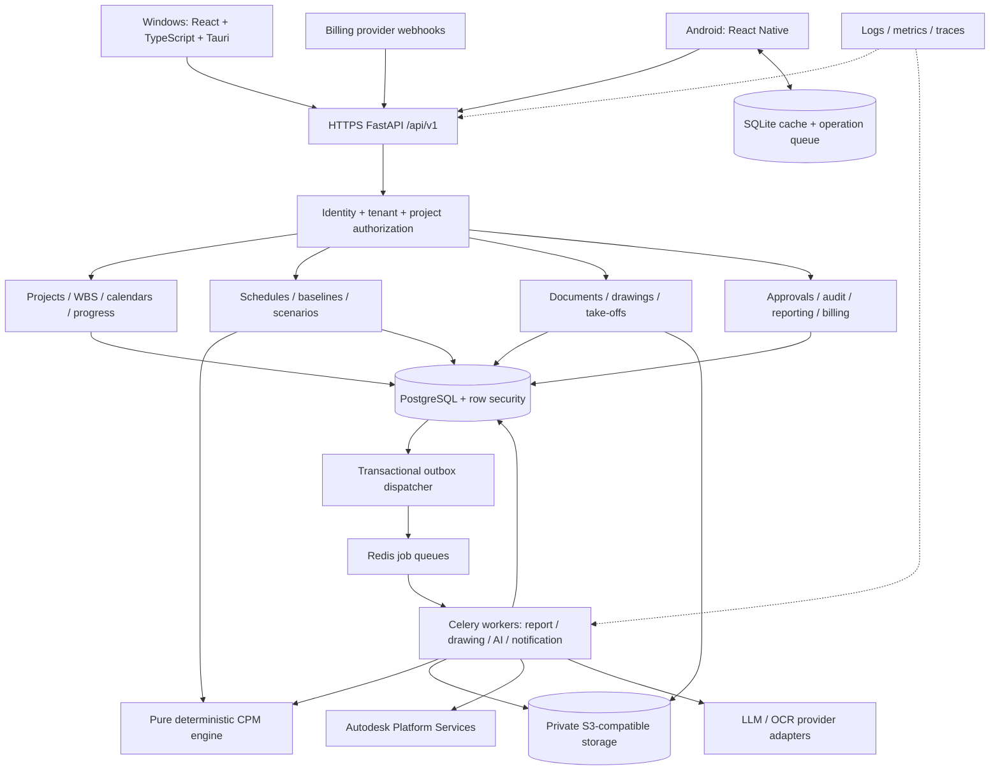

# ConstructPM AI — Architecture and Implementation Plan

Planning specification • 11 November 2026 • Proposed decisions for review

**Status: planning only. No application code, infrastructure, accounts, or database migrations have been created. Phase 1 requires explicit authorization.** All behavior below is proposed unless described as a requirement. This document defines the initial commercial scope, technical boundaries, and acceptance gates; it does not claim implemented or tested behavior.

## 1. Software architecture and component diagram

### Architecture decision

Use a modular FastAPI application with independently deployable Celery workers, a pure Python deterministic scheduling package, and one PostgreSQL system of record. Begin with a modular monolith to keep schedule publication, approvals, and audit events transactionally consistent. Modules own their tables and expose application services; other modules do not write those tables directly. Split services later only where operational evidence warrants it.

React/TypeScript/Tauri provides the Windows client. React Native provides the Android client with a SQLite cache and durable submission queue. Clients never connect directly to PostgreSQL, Redis, or privileged object-storage APIs. Desktop requires connectivity initially; only the Android field workflow includes offline editing in the initial scope.



Every request, background job, object access, and notification carries a verified organization scope. The outbox is committed with the business change; dispatch can retry without losing the change or producing duplicate business effects. Redis is transport/cache, never the authoritative record.

### Module ownership

| Module | Owns | Main boundary |
|---|---|---|
| Identity and tenants | Organizations, memberships, sessions, roles | Identity provider adapter; project permission checks |
| Projects and WBS | Project metadata, project membership, WBS, calendar definitions | Stable project/activity identities |
| Scheduling | Network inputs, calculations, diagnostics | Pure engine accepts immutable inputs and returns results |
| Baselines and scenarios | Version branches, approved baseline, published forecast pointer | No in-place modification of sealed versions |
| Progress and sync | Field observations, conflicts, operation receipts | Submitted observations require review before forecast incorporation |
| Documents and drawings | Files, revisions, pages, processing jobs | Quarantined files become available after validation |
| Take-offs | Measurements, formulas, quantities, approvals | Deterministic dimensional calculations |
| AI recommendations | Extraction runs, provenance, draft suggestions | AI cannot publish or approve |
| Approvals and audit | Requests, decisions, immutable events | Revalidate authority and subject hash on decision |
| Reporting | Saved snapshots, templates, generated artifacts | All formats consume the same snapshot |
| Subscriptions | Entitlements, subscriptions, webhook receipts | No card data stored in application |

Notification delivery is an adapter, with an in-app inbox first. Email/push and external integrations must respect project visibility. Future RFIs, submittals, inspections, resources and costs reference stable project, activity, document and revision identities without modifying historical schedules.

## 2. Proposed repository and folder structure

```text
constructpm-ai/
  apps/
    desktop/                 React UI, Tauri Rust shell, scoped capabilities
    mobile/                  React Native Android, SQLite, sync and secure storage
  services/
    api/
      app/
        identity/ projects/ scheduling/ scenarios/ progress/
        documents/ takeoffs/ ai/ approvals/ reporting/ billing/
        shared/              Request context, errors, authorization, transactions
      migrations/            Reviewed Alembic revisions
    workers/                 Celery adapters and outbox dispatcher
  packages/
    scheduling-engine/       Pure Python, calendar math, CPM, trace, fixtures
    quantity-engine/         Pure Python dimensional arithmetic and formula registry
    api-contracts/           Reviewed OpenAPI contract and generated TS types
    ui/                      Shared tokens and suitable React primitives
    report-templates/        Versioned PDF, DOCX and XLSX template inputs
  tests/
    integration/ tenant-isolation/ security/ e2e/ performance/
    fixtures/                Hand-checked networks and construction demo data
    recovery/                Restore and migration verification procedures
  infra/
    local/ cloud/ observability/
  docs/
    architecture/ decisions/ api/ scheduling/ security/ operations/ user-guides/
  .github/workflows/          Build, checks, dependency and artifact validation
```

Share API types, design tokens and domain concepts across clients, not platform-specific UI or SQLite implementations. Scheduling rules exist only in the Python engine; a client preview is labeled provisional until server-calculated.

## 3. PostgreSQL schema and relationships

This is a logical relational schema, ready to guide later migration design, rather than executable DDL. IDs are UUIDs generated before submission where offline creation requires them. Times use `timestamptz`; calendar dates use `date`; quantities use `numeric` with explicit precision and unit codes. Schedule durations use integer working minutes. Money, when introduced, uses decimal values plus ISO currency, never binary floating point.

### Common rules

All tenant-owned tables contain `organization_id NOT NULL`; project-owned tables also contain `project_id NOT NULL`. Composite foreign keys include organization and project scope, so cross-tenant and cross-project references fail even if an application check is missed. Each parent exposes the matching unique composite key. Mutable records have `row_version`, `created_at`, `created_by`, `updated_at`, and `updated_by`. Immutable snapshots have content hashes and creator metadata instead of editable business fields. Foreign-key deletes restrict removal of evidence; deactivation replaces destructive deletion where history depends on a record.

| Tables | Important fields and relationships |
|---|---|
| `users` | Global identity ID, issuer + subject unique, display name, disabled flag. Tenant-facing lookup returns only authorized membership data. |
| `organizations` | ID, name, status, region, default timezone, retention policy reference |
| `organization_memberships` | Organization + user unique; membership status; organization role |
| `invitations`, `sessions` | Hashed invite token, expiry, intended role; identity session/revocation metadata as needed by provider |
| `roles`, `permissions`, `role_permissions` | Seeded permission codes; optional custom roles after core roles are stable |
| `projects`, `project_memberships` | Organization; project code unique within organization; timezone, start, currency, units; per-project role/scope |
| `wbs_nodes` | Project, parent node, code, sort order; parent cycle validation |
| `activities` | Stable project-level identity, external code, discipline, lifecycle state; no version-specific dates here |
| `calendar_versions` | Immutable version, timezone, nominal minutes/day, parent reference resolved on sealing |
| `calendar_week_intervals`, `calendar_exceptions` | Calendar version, weekday/date, ordered local work intervals; exceptions override weekly pattern |
| `schedule_versions` | Project, branch type, parent version, status date, start anchor, calculation policy version, state, hash |
| `schedule_activity_states` | Version + activity unique; WBS assignment, name, type, calendar version, original/remaining minutes, constraints, progress references |
| `schedule_dependencies` | Version, predecessor, successor, FS/SS/FF/SF, signed lag minutes, explicit lag calendar version; no self-links |
| `schedule_calculation_runs` | Version hash, engine version, normalized-input hash, timezone data version, status, diagnostic summary |
| `schedule_activity_results` | Run + activity unique; ES/EF/LS/LF, total float minutes, critical flag, driving explanation references |
| `schedule_driver_edges` | Run, activity, source dependency/constraint/calendar event, bound and contribution; supports ties |
| `baselines` | Project, sealed schedule version, approved decision, approved date, original/rebaseline designation |
| `project_schedule_pointers` | Project unique; original baseline ID, active comparison baseline ID, published forecast version ID, row version |
| `scenarios`, `scenario_assumptions` | Source published version, branch version, narrative, assumption values/units/evidence, verification state |
| `progress_observations` | Activity, reporter, observed time, actual start/finish assertions, physical progress, quantities, labor hours, remaining duration, review state |
| `progress_reviews` | Observation, accepted/rejected fields, reviewer, reason; accepted observation immutable |
| `sync_operations` | Organization + actor + operation UUID unique; payload hash, base version, receipt/result, device and server sequence |
| `sync_change_log`, `sync_conflicts` | Tenant/project-scoped monotonically ordered changes and tombstones; conflicting base/current/proposed values and resolution |
| `files`, `file_uploads` | Private storage key, checksum, size, MIME, quarantine/clean state; upload expiry and owner scope |
| `documents`, `document_revisions`, `drawing_pages` | Logical document, immutable revision, prior revision, file, page/model object references |
| `scale_calibrations` | Drawing page + revision, coordinate transform, two or more verification references, units, scope/viewport, approver |
| `measurements` | Revision/page/object reference, coordinates, dimension inputs, calibration, measurement type, unit, confidence and review state |
| `takeoff_items`, `quantity_calculations` | Measurement references, versioned formula, exact inputs, dimensional units, unrounded result, rounding rule, approved result |
| `ai_runs`, `ai_suggestions` | Provider/model, prompt-template version, source hashes, extraction evidence, confidence, draft payload and approval linkage |
| `approval_requests`, `approval_decisions` | Subject type/ID/hash, source forecast version, state; approver, decision, reason, timestamp |
| `audit_events` | Tenant/project, actor/service, action, entity, before/after hash or controlled diff, request ID, timestamp; append only |
| `report_snapshots`, `report_artifacts` | Reporting period, status date, baseline/forecast run IDs, progress/photo selection, JSON data hash; template/renderer version, format, storage key |
| `subscriptions`, `entitlements`, `billing_events` | Provider IDs, state, effective dates; provider event ID unique; verified webhook hash |
| `outbox_events`, `jobs` | Tenant, aggregate/version, event ID, dispatch status; durable job status and deduplication key |

### Integrity and indexing

Schedule-version inputs, results, baseline references, measurements and reports retain immutable referenced calendar/document versions. A scenario is a new version with parent lineage. Original baseline pointer never changes; rebaselining creates a separately approved baseline and changes only the active comparison pointer.

Indexes begin with organization/project for common scoped queries, then version/activity, reporting date or change cursor as relevant. Add uniqueness for project activity codes, dependency identity, sync operation receipts and provider webhook IDs. Reject duplicate dependencies with ambiguous differing lag values unless explicitly represented as separate justified constraints. Check nonnegative remaining duration, valid states, ordered work intervals and compatible units. Validate graph cycles and state transitions in one transaction under version locking; SQL constraints alone cannot express all graph rules.

Use JSONB for immutable source payloads, trace details and extensible metadata, not as a replacement for core relationships. File blobs reside in object storage; checksums and access metadata reside in PostgreSQL. Audit access itself is restricted. Retention and privacy deletion require a documented policy that reconciles contractual record retention with personal-data obligations.

## 4. REST API design

### Shared contract

Base path `/api/v1`. OpenAPI is the contract source, reviewed with breaking-change checks. JSON uses UUID strings, ISO-8601 timestamps with offset, date strings and explicit units. Decimal quantity values travel as strings; duration is an integer count of minutes. Cursor pagination uses `items` and `next_cursor`, default 50 and maximum 200. GET requests have no side effects.

Organization context is selected using `/organizations/{org_id}` but always verified against the authenticated principal. Project membership and operation-specific permission are additional checks. Client-supplied tenant IDs never establish authority. Use OIDC authorization-code flow with PKCE in the system browser for native clients; short-lived API tokens, secure refresh-token storage and revocation. Registration and invitation acceptance are narrow unaffiliated endpoints with rate limits.

Mutable updates require `If-Match` with the current ETag; stale updates return 412. Command POSTs accept an `Idempotency-Key`; reusing a key with a different body returns 409. Long work returns 202 plus job ID and polling URL. Errors include `code`, `message`, `request_id`, field errors and safe diagnostic references. Use 401 for invalid authentication, 403 for known permitted-scope action denial, 404 to hide inaccessible records, 409 for business conflicts, 422 for invalid networks/inputs, and 429 with retry guidance. No exception stack traces reach clients.

### Endpoint inventory

Paths below organization context use prefix `/organizations/{o}`; project paths additionally use `/projects/{p}`.

| Area | Methods and paths | Permission / behavior |
|---|---|---|
| Enrollment | `POST /registrations`, `POST /invitations/{token}/accept`, `GET /me` | Verified identity; single-use invitation; no open role assignment |
| Organization | `GET/POST /organizations`; `GET/PATCH /organizations/{o}` | Membership discovery; creation; organization administration |
| Memberships | `GET/POST /memberships`; `PATCH /memberships/{id}` | Invite, deactivate, assign permitted roles; block removal of last administrator |
| Projects | `GET/POST /projects`; `GET/PATCH /projects/{p}`; `GET/POST /projects/{p}/memberships` | Organization and project permissions |
| Calendars | `GET/POST /calendars`; `POST /calendars/{id}/versions` | Editing creates a version; referenced calendars cannot be overwritten |
| WBS | `GET/POST /wbs`; `PATCH /wbs/{id}` | Draft network editing; stable ordering and cycle checks |
| Schedule drafts | `GET/POST /schedule-versions`; `GET /schedule-versions/{v}` | Branch from specific source; include source hash |
| Network edits | `POST /schedule-versions/{v}/changesets` | Atomic activity/dependency edits, expected version; draft only |
| Calculation | `POST /schedule-versions/{v}/calculations`; `GET /calculation-runs/{r}`; `GET /calculation-runs/{r}/activities` | Persist exact input and engine version; trace and diagnostics |
| Baselines | `GET /baselines`; `POST /baseline-proposals` | Approval required; no baseline overwrite endpoint |
| Scenarios | `POST /scenarios`; `GET /scenarios/{s}/comparison`; `POST /scenarios/{s}/assumptions` | Independent branch, explicit resource/productivity assumptions |
| Approvals | `POST /approval-requests`; `GET /approval-requests`; `POST /approval-requests/{a}/decisions` | Authority, separation of duties, subject hash, current source version |
| Publication | `POST /approval-requests/{a}/publish` | Idempotent authorized command; atomic pointer update + audit + outbox |
| Progress | `GET/POST /progress-observations`; `POST /progress-observations/{id}/reviews` | Assigned activity scope; supervisor cannot publish schedule |
| Mobile | `GET /assignments`; `POST /sync/push`; `GET /sync/pull?cursor=...`; `POST /sync/conflicts/{id}/resolve` | Independent per-operation receipts; scoped changes; reviewed conflict resolution |
| Files | `POST /uploads`; `POST /uploads/{id}/complete`; `GET /files/{id}/download` | Scoped short-lived URL; quarantine before consumption |
| Drawings | `GET/POST /documents`; `POST /documents/{id}/revisions`; `POST /revisions/{id}/processing-jobs` | Immutable revisions, job state; APS adapter where supported |
| Measurements | `POST /calibrations`; `POST /measurements`; `POST /takeoffs/{id}/calculations` | Revision-bound evidence and deterministic unit validation |
| AI | `POST /ai/extraction-runs`; `GET /ai/suggestions`; `POST /ai/suggestions/{id}/review` | Draft only; reviewer accepts into draft branch/measurement workflow |
| Reports | `POST /report-snapshots`; `POST /report-snapshots/{id}/exports`; `GET /report-artifacts/{id}` | Same immutable snapshot across formats; access rechecked on download |
| Billing | `GET /subscription`; `POST /billing/checkout-sessions`; `POST /webhooks/billing` outside tenant prefix | Billing admin; webhook signature and provider-event deduplication |
| Audit/jobs | `GET /audit-events`; `GET /jobs/{id}` | Scoped read; redacted operational detail |

### Representative payload contracts

* Schedule changeset: `expected_version`, `activity_upserts[{activity_id,wbs_id,name,type,calendar_version_id,remaining_duration_minutes,constraints}]`, `dependency_upserts[{id,predecessor_id,successor_id,type,lag_minutes,lag_calendar_version_id}]`, `deletions[]`. Validate the resulting whole network, not just individual records.
* Calculation result: `run_id`, `input_hash`, `engine_version`, `status_date`, `project_finish`, `activities[{id,es,ef,ls,lf,total_float_minutes,critical,driver_ids}]`, `diagnostics[]`. Failed runs do not replace previous valid results.
* Sync push: `device_id`, `operations[{operation_id,entity_id,base_row_version,kind,payload,observed_at}]`. Response per operation: `accepted|duplicate|conflict|rejected`, resulting row version, server receipt and conflict details where authorized. A batch transport success does not mean every operation succeeded.
* Approval decision: `decision`, `subject_hash`, `expected_source_forecast_id`, `reason`. Publication checks these again inside its database transaction.
* Snapshot request: `period_start`, `period_end`, `status_date`, `baseline_id`, `forecast_run_id`, `approved_observation_ids`, `photo_ids`, `template_version`. Server validates all sources belong to the same project and seals resolved content.

## 5. Deterministic CPM engine technical specification

### Scope and time model

The engine is a versioned, side-effect-free package: normalized immutable network + calendars + policy → results + trace + diagnostics. No LLM, database, network, random seed, machine-local timezone or wall clock is allowed inside calculation. Identical normalized inputs and engine/timezone-rule versions produce identical canonical results and hashes. Sort all ties by stable ID.

Represent event instants in UTC; interpret work intervals in a named project/calendar timezone. Use half-open working intervals `[start,end)` and integer-minute precision; define rounding when importing subminute inputs. Calendar versions contain weekly shifts, holidays, exceptions and nominal day length. Resolve daylight-saving ambiguities explicitly when expanding intervals; reject impossible or ambiguous shift definitions until resolved. A duration in “days” is converted using its recorded nominal minutes/day, not assumed to be 24 hours.

Define `advance(calendar,t,d)` to consume d working minutes from t, skipping nonworking intervals; define backward consumption as its inverse with documented endpoint rules. Zero-duration milestones are instants. Start snapping moves to the next permissible start; finish snapping handles a shift-ending instant as a valid finish. No hidden inclusive-date arithmetic. Lag has its own recorded calendar, defaulting to predecessor calendar on creation; users can select an explicit alternative. Changing project defaults never silently changes existing links.

### Network rules and forward pass

Leaf activities and milestones participate in the graph. WBS summaries roll up earliest child start/latest child finish and do not receive logic links or editable duration. Initial release has fixed-duration tasks, no resource leveling, no effort-driven scheduling and no automated crew-to-duration conversion. Validate missing calendars, missing nodes, self-links, cycles, invalid constraints and unreachable calendar horizons before calculation. Return a concrete cycle path to the user.

For predecessor i and successor j, let `S`/`F` denote starts/finishes and `L(t)` advance the explicit lag calendar by signed lag. Enforce:

| Link | Lower bound |
|---|---|
| FS | `S_j >= L(F_i)` |
| SS | `S_j >= L(S_i)` |
| FF | `F_j >= L(F_i)` |
| SF | `F_j >= L(S_i)` |

In topological order, find the earliest feasible successor start satisfying every start and finish bound, its own duration/calendar and allowed date constraints. For FF/SF convert a finish bound using the successor calendar and validate the resulting finish; do not subtract wall-clock duration. Lead is negative lag and may permit overlap. Bound searches must be monotonic calendar-aware searches with finite horizon checks. Capture every tied driver and relevant skipped work interval. Activities with no predecessors start from the project anchor or explicit authorized constraint; disconnected terminal activities still influence project completion.

Supported first-release constraints: ASAP, start-no-earlier-than, finish-no-earlier-than, start-no-later-than and finish-no-later-than. A target deadline is a separate reporting/backward-pass anchor and does not move early dates. Exact “must start/finish” constraints may be represented as equal lower and upper bounds only with explicit authorization; conflicts fail rather than silently overriding dependency logic. ALAP and other Microsoft Project modes are deferred and must be shown as unsupported on import.

### Backward pass, float and criticality

Project earliest completion is the maximum terminal finish. A virtual finish joins terminal nodes. Backward pass is anchored to this finish unless an explicit required completion deadline is selected and recorded. Reverse topological traversal applies inverse relationship bounds (including inverse lag-calendar mapping), successor limits, predecessor duration/calendar and upper constraints to find latest feasible events. Use calendar-aware inequality solving rather than assuming simple arithmetic inversion across different calendars. An infeasible required deadline produces negative float and diagnostics; impossible hard constraints are explicit failures.

Report total float as signed available working minutes between early and late start on the activity calendar, with calendar reference. Also retain late/early finish and absolute event instants; mixed-calendar floats must not be compared as if all “days” have equal length. A feasible activity with float at or below the configured zero-minute threshold is marked critical; negative float is highlighted separately. Derive critical driving chains from binding network edges and the completion/deadline anchor, including tied chains. A constrained activity can have zero float without belonging to a continuous completion-driving chain; the UI distinguishes those cases.

### Baseline, actuals and status date

Baseline dates/durations/links/calendars remain sealed. Actual observations are separate evidence; an approved observation is not overwritten when a forecast changes. A forecast run references accepted progress effective as of its status date and records all override policies.

* Not started: remaining work begins no earlier than status date, next allowed work interval and dependency bounds.
* Completed: retain accepted actual start/finish; remaining duration zero. Validate actual finish ≥ actual start and flag reported actuals after status date for review.
* In progress: retain actual start and any accepted execution segments; schedule remaining segment from status date under retained logic. Forecast finish is the remaining-segment finish, never a rewrite of actual history.
* Out-of-sequence actuals remain factual observations. Raise a diagnostic and apply retained logic to remaining work by default. A progress-override policy requires an explicit approved exception and appears in the calculation trace.
* Physical percentage, labor hours and remaining duration are independent. Duration percentage is a separate calculated measure; no automatic inference of remaining duration from physical percentage. Quantity-weighted progress requires approved scope and weights; WBS summaries state their aggregation basis and do not average arbitrary percentages.

Split completed/in-progress boundary handling into explicit event/remaining-segment constraints. Do not apply an unfinished-task forward/backward formula blindly to fixed actual dates. Test this policy separately for all four dependency types before release.

### Explainability and verification

For each changed activity report source version, direct driver, bound time, lag/calendar, nonworking intervals skipped, status-date effect and old/new values. Follow drivers recursively to explain project finish. Preserve all tied drivers. Diagnostics distinguish missing data, policy conflicts, impossible calendars, negative float and unverified assumptions.

Hand-checked fixtures cover all link types, positive/negative lag, multiple predecessors, multiple terminals, milestones, ties, constraints, five/six-day calendars, overnight work, holidays, leap dates, daylight-saving transitions, actuals and out-of-sequence progress. Add metamorphic tests: input ordering does not change outputs, branching cannot mutate source, extending a lower bound cannot make earliest completion earlier under unchanged assumptions. Compare a subset against an independently reviewed reference schedule; document differences in policy rather than claiming Microsoft Project equivalence. `.mpp` import/export is not included in the stated stack or initial scope; interchange formats require a separate decision.

### Demonstration project: 24 activities

This deliberately simplified network is a calculation acceptance fixture, not a site construction method statement. C5 is Monday–Friday, 08:00–12:00 and 13:00–17:00, 480 minutes/day. C6 adds Saturday on the same shifts. No holidays in this fixture. Baseline start: Monday 4 January 2027, 08:00, Pacific/Port_Moresby. All links FS with zero lag unless stated. Durations below are working days on the task calendar. A zero-day milestone may occur at the preceding task's finish instant.

| ID | Activity | Days | Calendar | Predecessors |
|---|---|---:|---|---|
| 01 | Notice to proceed | 0 | C5 | — |
| 02 | Mobilization | 2 | C5 | 01 |
| 03 | Survey and setting out | 2 | C5 | 02 |
| 04 | Earthworks | 4 | C6 | 03 |
| 05 | Foundation excavation | 3 | C6 | 04 |
| 06 | Foundation reinforcement | 3 | C6 | 05 |
| 07 | Foundation forms | 2 | C6 | 05 |
| 08 | Foundation pour | 1 | C6 | 06,07 |
| 09 | Foundation curing hold | 5 | C5 | 08 |
| 10 | Backfill | 2 | C6 | 09 |
| 11 | Slab preparation | 3 | C6 | 10 |
| 12 | Under-slab services | 2 | C6 | 11 SS +1 C6 day |
| 13 | Slab inspection | 1 | C5 | 11,12 |
| 14 | Slab pour | 1 | C6 | 13 |
| 15 | Slab curing hold | 5 | C5 | 14 |
| 16 | Structural steel procurement | 23 | C5 | 01 |
| 17 | Steel delivery milestone | 0 | C5 | 16 |
| 18 | Frame erection | 4 | C5 | 15,17 |
| 19 | Roofing | 3 | C5 | 18 |
| 20 | External enclosure | 4 | C5 | 19 |
| 21 | MEP first fix | 3 | C5 | 20 |
| 22 | Internal finishes | 4 | C5 | 21 |
| 23 | Testing and inspection | 2 | C5 | 22 |
| 24 | Handover milestone | 0 | C5 | 23 |

Curing values here are illustrative work-calendar holds; real curing specifications generally require explicit elapsed-time/technical hold definitions and approval. These fixture values must not be treated as concrete engineering advice.

Prototype actions: seal and approve baseline; publish identical initial forecast; supervisor submits delivery-availability change of +2,400 C5 working minutes for 17; reviewer accepts the event into a scenario. Recalculate downstream impacts and critical-chain changes without assuming completion slips exactly five days: foundation/slab readiness can absorb some or all delivery delay.

Compare A: accept changed availability with no other edits; B: user supplies proposed erection duration and supporting crew/productivity evidence, otherwise scenario remains incomplete with no claimed recovery; C: candidate starts enclosure after frame completion alongside roofing, only if safety/access/temporary-weatherproofing review approves removing `19→20` and adding `18→20`. Do not publish C as feasible merely because graph math permits it. Each branch has its own assumption register, source hash and comparison. No cost benefit is claimed without verified cost inputs.

The first prototype must calculate and display exact dates, total float, driving chains and milestone variance for completed scenarios. Those numerical outputs are intentionally not asserted in this planning document. The 24-activity fixture plus independent review becomes an acceptance test after implementation. Submission → separate authorized approval → atomic publication → assignment refresh → snapshot-based weekly report completes the demonstration.

## 6. Windows desktop layout and navigation

Application frame: organization/project switcher at top left; search, status date, notification inbox and account at top right; persistent left navigation. Project header always shows timezone, published forecast version, comparison baseline and editing state. An obvious draft/scenario banner prevents mistaking proposed dates for published dates.

```text
Organization / Project    Search      Status date      Notifications / Account
Overview       | Project / Schedule / Forecast v12 / Baseline B1
Schedule       | Published / Draft / Scenario tabs    Calculate / Compare / Submit
Progress       | WBS + editable grid        | Synchronized Gantt timescale
Scenarios      | ID Name Duration Calendar  | Bars, logic, baseline, actuals
Approvals      | ES EF LS LF Float Status   | Milestones and variance
Drawings       | Selected activity: drivers / progress / notes / audit
Take-offs      | Validation and assumption panel; actionable error links
Reports        |
Project setup  |
Organization   |
```

Grid supports keyboard editing, multi-cell paste with preview, undo within unsaved draft, column presets, WBS collapse, filters and dependency inspector. Gantt and grid share selection and scroll. Distinguish baseline, actuals, remaining work and scenario bars with patterns/labels as well as color. Cycle errors select involved rows; calendar tooltips explain skipped days. Large schedules use virtualized rows and bounded server queries. No automatic publication from a drag action.

Dashboard shows forecast completion, baseline variance, critical milestones, reviewed physical progress with its basis, blockers, unresolved observations and approval queue. “Schedule time elapsed” is separately labeled and never presented as physical completion. Export displays snapshot period/version before generation. Accessible keyboard navigation, readable contrast and scalable text apply throughout.

### Roles and available actions

| Role | Default view and permitted actions |
|---|---|
| Organization administrator | Memberships, project setup, tenant settings; no automatic schedule approval unless separately assigned |
| Project manager | Project overview, scenarios, review progress, submit changes; approval only under configured project policy |
| Planning engineer | Schedule grid, calendars, calculations and scenario preparation; cannot approve own submission |
| Site engineer | Assigned activities, verify observations, blockers and drawings; limited draft edits by permission |
| Supervisor | Assigned work, submit observations/photos/delivery blockers; no baseline or forecast publication |
| Quantity surveyor | Drawings, calibrated measurement, take-off review and quantity reporting |
| Executive | Read-only portfolio/project summaries and approved reports; approval only when explicitly assigned |
| Subcontractor / guest | Explicit project/activity/document grants, limited observation submission or read-only access |

Permissions are checked server-side and can combine roles subject to separation-of-duty rules. Organization billing administration is a separate permission. UI hiding is convenience, not security.

## 7. Android mobile workflow

1. Sign in while online, select organization/project, download assigned activities, published forecast, permitted drawing revisions and project calendar summaries. Display last successful sync and offline scope.
2. Open Today/Assigned Work, choose activity, read approved dates and current instructions. Enter observed quantities, units, physical progress if authorized, hours, remaining duration, actual dates, note/blocker and photos independently.
3. Save to SQLite in one local transaction with an operation UUID and base row version. Display “saved on device,” then “submitted,” then “reviewed”; distinguish these states from schedule publication.
4. Queue photo files with hashes and resumable/chunked transfer where storage supports it. Submit references only to finalized uploaded files. Interrupted photo transfer does not discard the observation.
5. On connectivity, refresh access, push operations with backoff/jitter, record durable server receipts, then pull scoped changes using server cursors. Retries use the same operation ID and payload. Server writes the domain record and receipt atomically.
6. Append-only observations normally coexist. Concurrent edits to the same observation or remaining-duration assertion create conflicts; never silently last-write-wins quantities or actual dates. Reviewer sees base/current/proposed values and chooses or creates a documented resolution.
7. Published schedule changes arrive through the change feed. Highlight revised assignments and let users acknowledge receipt; acknowledgment does not approve the change.

Server receipt time orders synchronization; device time records the observation time but cannot establish authority or precedence. UUID payload mismatch is rejected. Pull cursors exclude inaccessible projects and include tombstones/access revocation. Expired cursors require scoped resnapshot without dropping pending operations. SQLite schema migrations preserve queued operations. Use OS-protected encryption keys and encrypted local storage/attachments, subject to library selection. Logout removes accessible local data after explicitly handling unsent work; revoked devices cannot sync. Offline authorization has a configurable expiry; remote wiping cannot be guaranteed while a device stays offline. Test application termination during each synchronization boundary and reinstall/recovery limitations.

## 8. Drawing processing and AI quantity verification

Pipeline: authorized upload → checksum/MIME/size validation → quarantine and malware scan → immutable drawing revision → PDF extraction or APS translation → page/object indexing → manual/assisted scale verification → measurement capture → deterministic quantity calculation → human review → approved take-off → optional activity suggestions into schedule draft.

PDF vector coordinates are retained where available. Raster OCR detects labels/dimensions as evidence, not ground truth. Store crop/viewport transforms and page rotation. Calibrate each relevant viewport using known dimensions and cross-check an independent dimension. Scanned distortion or conflicting horizontal/vertical scale blocks automatic area/volume acceptance. Written “not to scale” or missing dimensions requires manual dimensions or another verified source; AI must not invent them. Separate viewports/details can have different scales.

For CAD/BIM, query APS-supported format/translation capabilities rather than promise all formats. Keep original revision, translation manifest, model object ID and source units. APS translation is not proof that a model property is a reliable contractual quantity; validate units, object classification, duplicates and model completeness. Commercial licensing, processing location and customer consent are release decisions. [Autodesk Model Derivative reference](https://aps.autodesk.com/en/docs/model-derivative/v2/reference/http/).

Every result stores source document/revision/page/object, geometry or explicit dimensions, calibration, units, formula version, deductions, multiplication factors, unrounded result, display rounding and reviewer. Examples: length from calibrated polyline; net area = polygon area minus explicit openings; volume = verified net area × verified thickness. Validate dimensions before arithmetic, and distinguish count, length, area, volume and mass. Missing thickness produces “quantity incomplete,” not an assumed volume. Waste/allowance is a separately approved factor, never hidden in geometry.

Specifications are optional. Without them, produce drawing-based quantities with unspecified grade/finish fields explicitly unresolved. With them, link specification clause and revision to each refined material/measurement rule; conflicting drawing/specification requirements create a review issue. Measurement standard, deduction rules and precedence require project settings.

LLM outputs use a constrained structured schema, evidence locations and uncertainty flags. Treat document text as untrusted input; embedded instructions cannot trigger tools, reveal secrets or change permissions. Limit provider context to authorized revisions and redact unnecessary personal data. Store model/template version and source hashes. AI may suggest activities, quantities and dependencies only as drafts; approved measurements still pass deterministic arithmetic and human checks. Revision changes flag affected quantities stale; never silently reuse old calibration/geometry. Benchmark extraction accuracy and reviewer correction rates before offering automation claims.

## 9. Security and tenant isolation

Use defense in depth: verified identity → organization membership → project/record/action permission → tenant-scoped query → PostgreSQL row-level security. All tenant tables enable and force RLS; production application and worker roles are neither table owners, superusers nor `BYPASSRLS`. Migration ownership is a separate credential. PostgreSQL documents that owners normally bypass RLS and privileged roles need special treatment. [PostgreSQL row security](https://www.postgresql.org/docs/17/ddl-rowsecurity.html).

Set authenticated tenant context transaction-locally through trusted server code; missing context denies access. Never use a request header alone as proof of tenant membership. Reset pooled connection context and test connection reuse across tenants. Restrict raw SQL and security-definer functions; composite foreign keys prevent cross-scope references. RLS does not replace endpoint authorization or project-level policy.

Other controls:

* Short-lived credentials, mandatory MFA for administrators/approvers, rate limits and audited invite/role changes. Use a proven identity provider; do not build a password system casually.
* Private storage, opaque tenant-scoped keys, encrypted transport/storage and short-lived signed URLs after permission checks. Recheck permissions for exports, thumbnails, model derivatives and search results. Separate quarantine from clean files.
* Job records contain tenant, initiating principal/service scope and immutable input IDs; workers load scope from trusted records, recheck access for sensitive execution, and never use a job-supplied arbitrary storage key or URL. Use per-tenant quotas and bounded queue concurrency.
* Celery handlers are idempotent, with database effect keys, atomic state transitions and retry/dead-letter procedures. Delivery acknowledgment settings do not guarantee exactly-once behavior. [Celery task guidance](https://docs.celeryq.dev/en/latest/userguide/tasks.html).
* Tauri capabilities allow only required native commands, file paths and origins. Keep untrusted documents/remote content away from privileged webviews. Signed Windows installers/updates and Android releases have separate production signing credentials. [Tauri capability model](https://v2.tauri.app/reference/acl/capability/).
* Secrets manager, rotated service credentials, least-privilege storage/APS/AI identities, no secrets or raw drawings in general logs. Logs carry request/tenant IDs with controlled access and retention.
* CSRF protections where cookies are used, explicit CORS allowlists, input validation, safe report templating, dependency scanning, signed builds and independent security review before commercial release.
* Approval state machine: draft → calculated/validated → submitted/frozen → approved or rejected → published. Edits invalidate submission. Default: submitter cannot approve; approver needs current project authority. A changed source forecast makes approval stale. Publish locks the pointer, compares expected source and hash, commits pointer + audit + outbox atomically. Repeated publish returns the original receipt.
* Backups include PostgreSQL point-in-time recovery, object versions, configuration and recoverable keys. Redis can be rebuilt from durable jobs/outbox. Proposed release targets: database RPO ≤15 minutes, service RTO ≤4 hours, and object recovery consistent with acknowledged upload durability; validate feasibility and cost before commitment. Conduct isolated full restore drills and reconcile file checksums, baseline hashes and tenant controls.

Deployment proposal: separate development/staging/production accounts and data; managed PostgreSQL, private Redis, private S3-compatible storage, containerized API/workers behind TLS ingress, and centralized observability. No public database. Scale workers by queue; rate-limit expensive translation/AI/report tasks. Monitor schedule calculation failures, queue age, sync conflicts, export errors, tenant-access denials, backup freshness and recovery drills. Do not introduce Kubernetes until scale/operations justify it.

## 10. Prioritized implementation backlog

Each backlog item follows the same feature dossier: purpose, dependencies, data/API changes, UI, acceptance tests, smallest implementation, demonstration, limitations and remaining work. Major-phase transitions require explicit user approval even after tests pass. Acceptance statements below are future gates, not completed checks.

| ID / phase / priority | Feature and purpose | Dependencies | Acceptance gate |
|---|---|---|---|
| F01 / 1 / P0 | Repository, contracts, CI and local services | Implementation authorization | Clean checkout builds clients/API; contract lint and migrations run; no production secrets |
| F02 / 1 / P0 | Organization registration, identity and invitation | F01, identity choice | Verified registration, single-use invites, revoked/expired tokens rejected; no role escalation |
| F03 / 1 / P0 | Tenant/project authorization | F02 | Cross-tenant CRUD, guessed IDs, search, exports, files, jobs and pooled connections all denied; empty context denies |
| F04 / 1 / P0 | Projects, memberships and audit | F03 | Role matrix tests; append-only audit; last administrator protection; scoped project lifecycle |
| F05 / 1 / P0 | Versioned calendars and desktop shell | F04 | Shift/holiday/exception validation; accessible project navigation; referenced versions cannot change |
| F06 / 1 / P0 | Migration and basic recovery harness | F01–F05 | Empty/previous-schema upgrade and isolated restore pass; queued business data and scope remain intact |
| S01 / 2 / P0 | WBS, activity grid and draft versions | Phase 1 approval | Atomic paste/edit, stable IDs, parent-cycle validation, optimistic concurrency |
| S02 / 2 / P0 | Calendar arithmetic and dependency graph | S01, F05 | All four links, signed lags, milestones and calendar boundaries match hand-checked fixtures; cycle path returned |
| S03 / 2 / P0 | Forward/backward CPM and traces | S02 | ES/EF/LS/LF/float, tied drivers, deadlines and critical chains verified; deterministic hashes |
| S04 / 2 / P0 | Actuals, remaining work and status date | S03 | Completed dates fixed; out-of-sequence rules explicit; physical progress/hours/duration stay independent |
| S05 / 2 / P0 | Baseline preservation and Gantt | S03–S04 | Sealed inputs/calendars immutable; baseline/actual/forecast rendered separately; grid/Gantt consistent |
| S06 / 2 / P0 | 24-activity fixture and performance | S05 | Independent reference review; repeatability, calendar and isolation suite passes; benchmark recorded |
| D01 / 3 / P0 | Scenario branches and comparison | Phase 2 approval | Branch edits never alter baseline/published forecast; assumptions visible; source staleness detected |
| D02 / 3 / P0 | Approvals and publication | D01 | Self-approval blocked, frozen hash checked, concurrent publication safe, exactly one published effect |
| D03 / 3 / P0 | Delay demonstration | D02 | Five-workday delivery observation; three options; unverified crew option remains incomplete until supplied; traceable calculated comparisons |
| D04 / 3 / P0 | Reporting snapshots and PDF/DOCX/XLSX | D02 | Values/dates/units match across all formats; source hashes retained; page and spreadsheet visual checks pass |
| D05 / 3 / P1 | Management dashboard and inbox | D03–D04 | Published data only by default; period/status/baseline clear; no elapsed-time/physical-progress confusion |
| M01 / 4 / P0 | Android assignment cache and forms | Phase 3 approval | Offline create/view works after restart; assignment scope enforced; independent progress fields |
| M02 / 4 / P0 | Durable sync, conflicts and photos | M01 | Duplicate, reorder, timeout-after-commit, crash, stale cursor, revoked access and partial photo tests pass without lost/duplicate observations |
| M03 / 4 / P1 | Review and changed-assignment acknowledgment | M02 | Pending/conflicted/reviewed/published states visible; review does not silently publish forecasts |
| Q01 / 5 / P0 | Upload/revision/PDF processing | Phase 4 approval | Quarantine, permission, immutable revisions and invalid file tests pass |
| Q02 / 5 / P0 | Calibration and quantity engine | Q01 | Known length/area/volume/unit fixtures pass; missing dimensions block approval; all provenance retained |
| Q03 / 5 / P1 | APS CAD/BIM adapter | Q01, APS decision | Chosen formats tested; unsupported formats and failed translations reported; object units verified |
| Q04 / 5 / P1 | AI drafts and specification enrichment | Q02, provider/privacy decisions | Evidence-backed drafts only; no invented dimensions; injection tests; drawings-only path works; stale revision warnings |
| C01 / 6 / P0 | Subscription entitlements and billing | Phase 5 approval, provider choice | Signed/deduplicated out-of-order webhooks; grace/read-only policy; no payment data exposure |
| C02 / 6 / P0 | Harden deployment, backup and monitoring | C01, prior security work | Restore drill meets agreed RPO/RTO; alert exercises; tenant isolation security review; signing and rollback tested |
| C03 / 6 / P0 | Performance, pilot and release gate | C02 | Agreed load targets pass; representative pilot; runbooks/support policy; no unresolved critical defects |

### Cross-cutting quality and release gates

Use unit tests for pure calculations; integration tests against real PostgreSQL/RLS/object storage; Android SQLite failure-injection tests; API authorization and concurrency tests; desktop/mobile end-to-end workflows; template content and visual checks; migration and disaster-recovery drills. Known examples must include independently derived expected results, not only snapshots from the implementation itself.

Provisional benchmark targets for sizing discussion: 10,000 activities and 30,000 links per project; calculation p95 ≤5 seconds on a documented worker for a normal one-year calendar horizon; ordinary paginated reads p95 ≤500 ms at agreed concurrent load; initial mobile assignment scope bounded to 500 activities. These are proposed acceptance targets, not measured performance. Calendar expansion horizons and traces must be bounded to prevent denial of service.

At each phase close: demonstrate its workflow, present test evidence and limitations, preserve migration/rollback instructions, list unresolved defects and request authorization for the next phase. Resource leveling, advanced cost forecasting, advanced portfolio analysis, additional planning modes and iOS remain deferred. Executive summaries can span projects without implying advanced portfolio planning.

## 11. Development environment setup plan

No setup commands have been executed. Exact compatible versions will be selected and locked at implementation kickoff after checking official support matrices; do not float production on “latest.”

1. Prepare Windows development machines with Git, a supported Node LTS and package manager, supported Python, Rust stable/MSVC tools, Windows WebView2 and Tauri prerequisites. Android development needs Android Studio, an SDK/emulator or test device and a compatible JDK/React Native toolchain. Verify the Windows/Android version support policy before choosing versions.
2. Select a container runtime appropriate to the team and configure local PostgreSQL, Redis and a development S3-compatible store. Use synthetic tenant data only. Keep client builds native where platform tooling requires it.
3. Create isolated Python environment and locked JS/Python/Rust dependency files; separate development and production dependency groups. Provide documented bootstrap/check commands after implementation authorization.
4. Supply a checked-in environment-variable example containing names only: database/Redis/storage endpoints, identity issuer/audience, signing placeholders, APS/AI adapter settings and billing test credentials. Real secrets live in local secure configuration or a secrets manager and never in the repository.
5. Run migrations using a migration-only identity; run API/workers using restricted application identities with RLS. Seed two synthetic tenants, representative roles, calendars and the demonstration network.
6. Start API, outbox dispatcher and workers; run desktop development UI, then Android emulator. Verify API schema, sign-in redirect, tenant denial, job lifecycle and offline reconnect.
7. CI uses reproducible environments for engine/API checks, Windows Tauri builds and Android checks; production signing keys remain in restricted release jobs. Staging uses separate identities, buckets and databases.
8. Document initial migration, upgrade, backup, restore, failed-job replay, desktop update rollback, mobile cache migration and provider outage procedures. Desktop/mobile clients must handle compatible older API versions during staged rollout.

### Proposed additional dependencies — explanation before adoption

These are candidates for approval through implementation review, not installed dependencies or claims of verified current compatibility.

| Candidate | Purpose / decision condition |
|---|---|
| SQLAlchemy + Alembic + Psycopg | PostgreSQL access and reviewed schema evolution; avoid handwritten persistence plumbing |
| Pydantic/OpenAPI tooling | Typed validation and generated client contracts; FastAPI-native integration |
| A maintained OIDC client/provider SDK | Standards-based sign-in, MFA and token validation; provider still undecided |
| TanStack Query / Table / Virtual | Server-state caching and large editable schedule grids; evaluate bundle size and editing behavior |
| Gantt component or small custom renderer | Evaluate dependency routing, virtualization, accessibility and commercial license before selecting; it never owns CPM math |
| React Native SQLite + secure-storage binding | Durable field queue and OS key protection; encryption support and migrations are selection gates |
| PDF.js; vetted PDF extraction/OCR tools | PDF preview/text extraction; review licenses and isolate parsers/OCR workers |
| python-docx, openpyxl, chosen PDF renderer | Snapshot-driven Word/Excel/PDF exports; font licensing and pagination must be verified |
| S3 SDK and APS SDK/HTTP adapter | Scoped object transfers and supported model translation; use minimal provider permissions |
| pytest, property-based testing, Playwright, mobile E2E tool | Independent calculation, failure and UI verification; mobile tool chosen after RN compatibility check |
| OpenTelemetry and metrics/error backend | Request/job tracing and operational alerts with tenant-safe redaction |
| Malware scanner and secret manager adapter | Quarantined uploads and controlled service secrets; managed versus self-hosted decision |

Review maintenance, security history, license terms, platform support and compatibility before adoption. No UI library or AI service may replace the authoritative scheduling or quantity engines.

## 12. Risks, assumptions and unresolved decisions

| Risk / decision | Proposed position | Required clarification or mitigation |
|---|---|---|
| Scheduling semantics differ from Microsoft Project | Define explicit semantics; verify reference fixtures | Does “Microsoft Project-style” mean UI/logic familiarity, XML interchange, or exact file compatibility? Native `.mpp` requires separate scope/licensing evaluation. |
| Mixed calendars and actuals can invalidate naive CPM | Event/remaining-segment model and bounded calendar-aware solver | Approve lag default, retained-logic policy, constraint set, nominal-day conversion and deadline behavior. |
| Extra crew does not imply predictable recovery | Manual verified duration assumption first | Who supplies productivity evidence and approves constructability/resource feasibility? No leveling in initial release. |
| Region, privacy and contractual retention | Region-specific deployment and provider consent | Which countries, data-residency requirements, retention periods and customer contract terms apply? |
| Subscription/tax/payment availability | Provider adapter and separate entitlements | Launch countries, billing currency, tax treatment, payment provider, plans, seat/project/storage limits and overdue policy? |
| Role conflicts and approval staffing | Default separate submitter/approver | Who may approve forecasts/baselines/take-offs; may small organizations request a documented exception? |
| Offline access after revocation | Time-limited offline grants and encrypted cache | Maximum offline period, shared-device support and unsent-data/logout policy? |
| Take-off uncertainty and measurement standards | Explicit scale/evidence and reviewer sign-off | Which measurement standard, units, rounding, deductions, specification precedence and initial disciplines? |
| CAD/BIM costs and source reliability | Optional APS adapter in Phase 5 | Required file formats/versions, sample files, APS account/region and processing budget? |
| AI privacy, accuracy and vendor drift | Minimal authorized context, provider adapter, versioned evaluation | Approved provider, no-training/retention requirements, usage budget and representative review dataset? |
| Scope and performance expansion | Benchmark proposed project size and bounded jobs | Expected tenant count, concurrent users, schedule size, file size and photo volume? |
| Report acceptance | Snapshot consistency plus visual review | Required company branding, report sections, weekly cutoff, timezone and signatories? |
| Operations and recovery cost | Managed infrastructure; proposed RPO/RTO | Budget, cloud preference, support hours, availability target and recovery objectives? |
| Toolchain and licensing | Lock supported compatible versions at kickoff | Target Windows/Android minimum versions; commercial Gantt/OCR/font license budget? |
| Tenant restore and deletion | Shared-schema default, optional dedicated deployment later | Is contractual per-tenant point-in-time restore or dedicated database isolation required? |

Planning assumptions: one organization is the tenant boundary; users may belong to several organizations but select one scoped context; schedules belong to one project; project timezone is explicit; desktop initially operates online; Android submits observations offline; baseline is immutable; changing forecast requires approval; monetary recovery and resource feasibility are not inferred from dates; no application may treat an AI draft as approved work.

The highest-impact decisions before Phase 1 are identity provider, deployment/data region, role/approval policy, target platform versions and initial scale. Scheduling and measurement policy decisions can be resolved before their phases, with proposed defaults visible above. No implementation is authorized by this document. **Stop here and wait for explicit instruction to implement Phase 1.**
